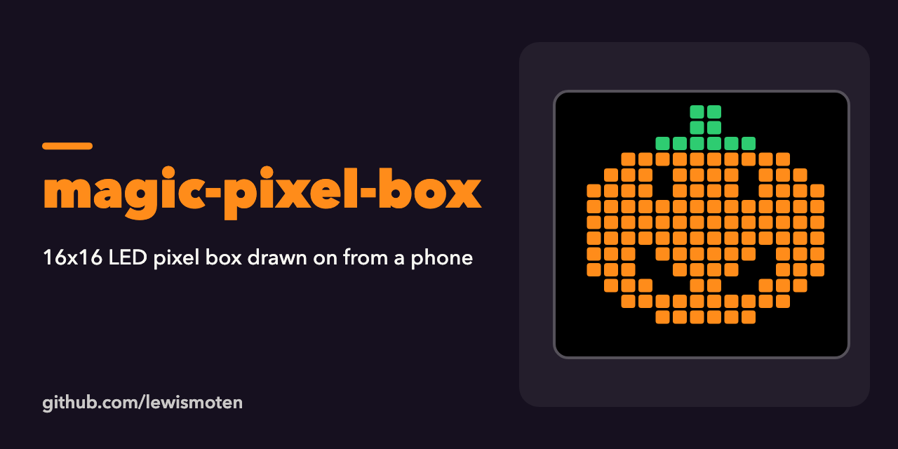

# magic-pixel-box

Arduino sketches for a 16x16 RGB LED pixel box (256 LEDs) that can be drawn on from a phone over Bluetooth LE.

- `pumpkin/`: draws a 16x16 pumpkin on the LED strip (with the source pixel art).
- `bluetooth-color-matrix/`: reads and writes single pixels over Bluetooth.
- `bluetooth-server/`: a Bluetooth LE server for an board with Bluetooth LE (such as an ESP32).
- `magic-pixel-box-server3/`: the third version of the server, with screenshots of the phone app (drawing tools, file I/O, Bluetooth connection).

Status: experiment from 2018, not maintained. Open a sketch in the Arduino IDE; the LED sketches use the PololuLedStrip library on data pin 2.
